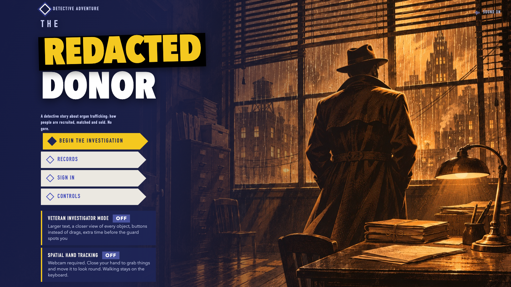
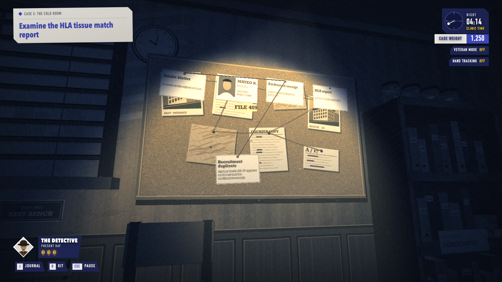
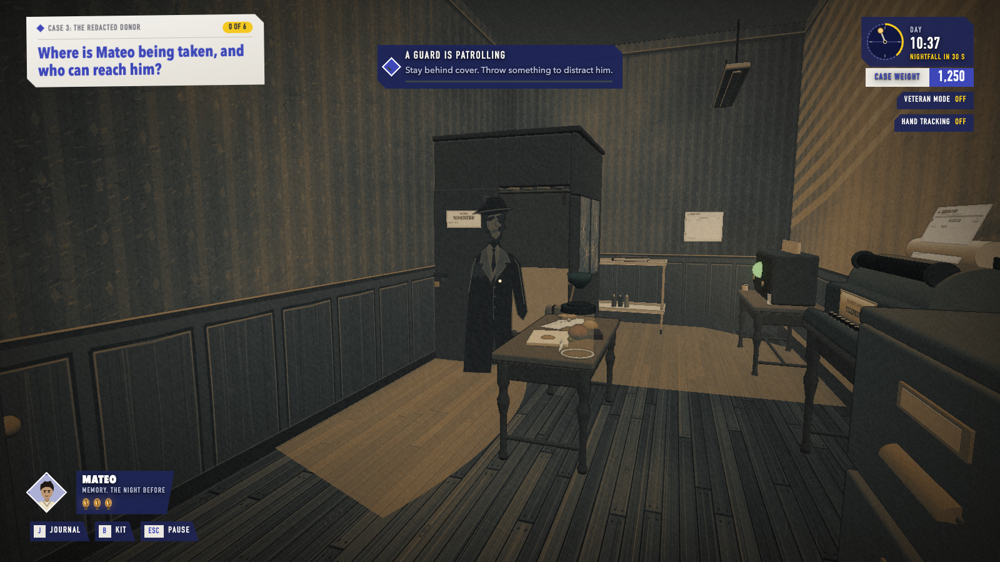
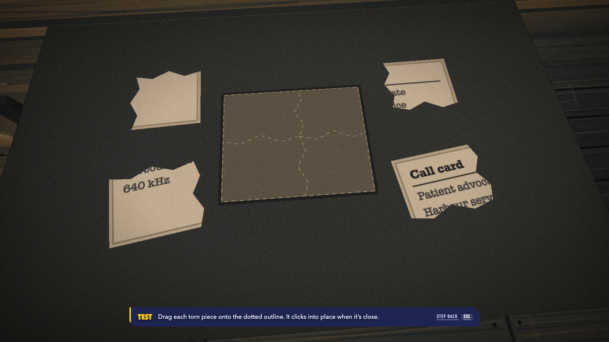
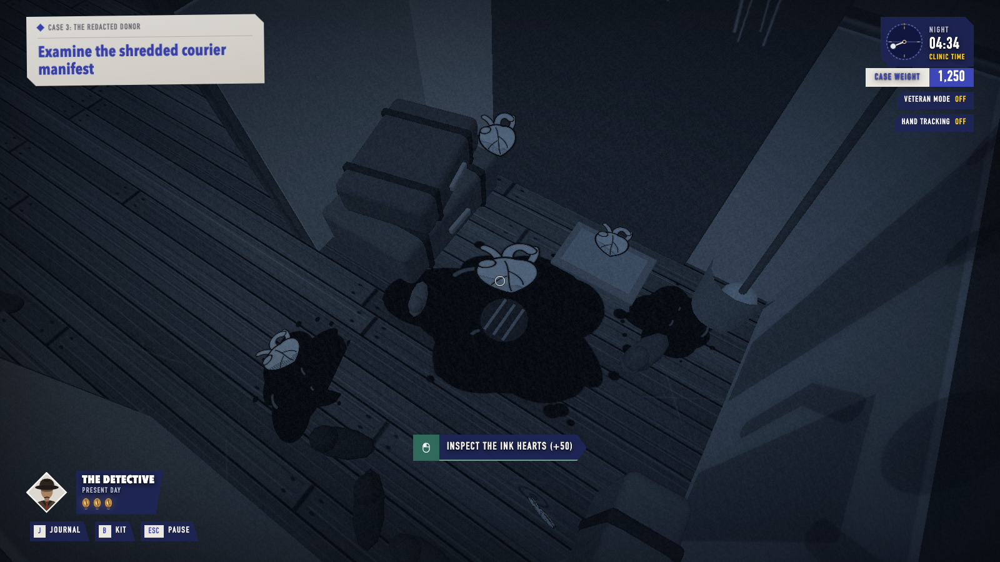

# The Redacted Donor

A 3D detective game about organ trafficking: how people are recruited, matched and sold. No gore.

**[Play it in your browser](https://yellowfangbuisness-hue.github.io/the-redacted-donor/)** (Chrome or Edge on a computer; nothing to download or install).



Made for the Oakridge Hackathon. The whole game is a single web page drawn in an ink-noir style. It runs offline, in a browser, as a Mac app or from a Windows folder.

## The story

You play two people in the same rooms.

**Mateo** answers an advert for a lab job abroad: good pay, no visa needed, a free "medical" with a blood and tissue test. The agency is not what it says. In his memories you find and hide evidence around a clinic while a guard patrols.

**The detective** searches the same rooms later, recovers what Mateo hid, checks that each lead is true, and connects it on an evidence board. There are three cases, and then a race to call for help.

The game teaches how this crime works in real life: the job or loan offer, the "routine" medical test, the paperwork signed under pressure. After the ending there is a short quiz and a set of cards on warning signs, common myths and where to report, with links to the sources.

| | |
| --- | --- |
|  |  |
|  |  |

## Play it

| On | Do this |
| --- | --- |
| **Windows** | Download [The Redacted Donor (Windows).zip](The%20Redacted%20Donor%20%28Windows%29.zip), unzip it, and double-click **Play The Redacted Donor**. It opens in Edge or Chrome. |
| **Mac** (Apple silicon, macOS 13 or later) | Download this repository (green **Code** button, then **Download ZIP**) and open **The Redacted Donor.app**. |
| **Any computer** | Download this repository and open `index.html` in Chrome or Edge. |

Good to know:

- Nothing needs installing and no internet is needed. Your progress is saved on your own computer.
- Keep `hand-tracking.js` next to `index.html`. The game only uses it if you turn hand tracking on.
- The Mac app is not registered with Apple. If macOS refuses to open it, go to System Settings, Privacy & Security, and choose **Open Anyway**.

## Controls

| Action | Keyboard and mouse | Controller |
| --- | --- | --- |
| Walk | W A S D | Left stick |
| Look | Mouse or arrow keys | Right stick |
| Interact / hold | E | A |
| Crouch / stand | C | B |
| Run | Shift | LT or click the left stick |
| Throw (hold to aim) | G | RT or RB |
| Lab coat kit | B or Tab | Y |
| Field journal | J | X |
| Watch overdrive | O | Back / View |
| Turn over a document | F | LB |
| Pause | Esc | Start / Menu |
| Hand tracking on or off | H, anywhere | Pause menu |

In menus and puzzles the mouse points and a click presses or drags. On a controller the sticks move a pointer and A presses.

## Two optional modes

**Veteran Investigator Mode** makes the game gentler: larger text, a closer view of every object, buttons instead of drags, and extra time before the guard spots you.

**Spatial Hand Tracking** lets you play the puzzles with your hands through a webcam. Close your hand to grab something, open it to let go, and move your hand toward a screen edge to look round. Walking stays on the keyboard. A four-step setup measures your hand the first time, and a short tutorial follows. Press **H** at any time to switch it on or off. The camera picture is read on your computer and is never stored or sent anywhere.

## What is in the game

- Three cases, each with six leads to find as Mateo and a lead to verify as the detective.
- A day and night clock. Some leads only show by day and some only at night.
- Guards who see, hear, chase and search, and objects you can throw to draw them away.
- 19 hands-on puzzles: drawers, padlocks, torn cards, radio dials, a UV lamp on glass and more.
- Four rooms: an intake office, a lab, a dispatch office and a hidden holding cell.
- Recorded voice lines, a jazz score, and a heartbeat that follows the danger you are in.
- An optional online leaderboard and cloud saves. The game is fully playable without them.

## How it is built

- Plain JavaScript and [Three.js](https://threejs.org), with no game engine. The rooms, furniture, characters and documents are built and painted by code when the game starts.
- About 8,800 lines of source in `src/`. `build.mjs` bundles everything into one `index.html` with [esbuild](https://esbuild.github.io).
- Hand tracking uses Google's [MediaPipe](https://ai.google.dev/edge/mediapipe/solutions/vision/hand_landmarker) hand model, run on a background thread so the game stays smooth.
- An ink shader draws the outlines, paper grain, and day and night light over the 3D scene.

For a plain-English tour of the code, read [The Redacted Donor - Code Explained.pdf](The%20Redacted%20Donor%20-%20Code%20Explained.pdf). `HANDOFF.md` has the full developer notes.

### Build it yourself

You need [Node.js](https://nodejs.org) (tested with version 24).

```bash
npm install
npm run build        # writes index.html and hand-tracking.js
npm start            # serves the folder at http://localhost:4173
```

`npm run build:mac` also packages the Mac app (needs a Mac with Xcode's command line tools). `npm run build:win` also makes the Windows folder and zip.

### Tests

```bash
npm test                      # the hand-tracking engine, 32 tests
node tools/save.test.mjs      # saves load safely, story rules
```

A third set drives the whole game in real Chrome with scripted hands, keys and a controller (64 checks). It needs `playwright-core` and the local server running; `HANDOFF.md` explains how to run it.

## What is where

| Path | What it is |
| --- | --- |
| `index.html`, `hand-tracking.js` | The built game and the hand-tracking files it loads on request |
| `src/` | The source code, art and sound |
| `build.mjs` | The build script |
| `native/` | The Mac app host (Swift) and the Windows launcher |
| `tools/` | The tests |
| `supabase/` | The database definition for the optional online records |
| `pitch/` | Screenshots and the source of the code guide |
| `The Redacted Donor.app`, `The Redacted Donor (Windows)/` | The packaged game for Mac and Windows |

## Credits

- [Three.js](https://github.com/mrdoob/three.js) (MIT licence) draws the 3D scene.
- [MediaPipe Tasks Vision](https://github.com/google-ai-edge/mediapipe) and its hand model (Apache 2.0 licence) find the hands.
- The facts in the game's debrief come from the Declaration of Istanbul, the UN Office on Drugs and Crime, the World Health Organization and India's National Organ and Tissue Transplant Organisation. The game links to each source.
